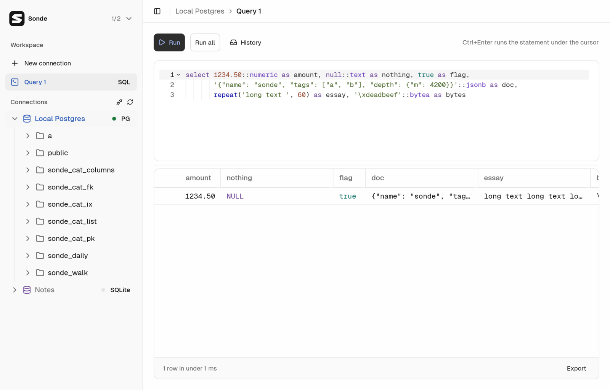
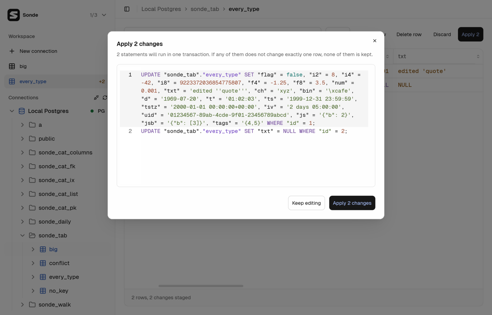
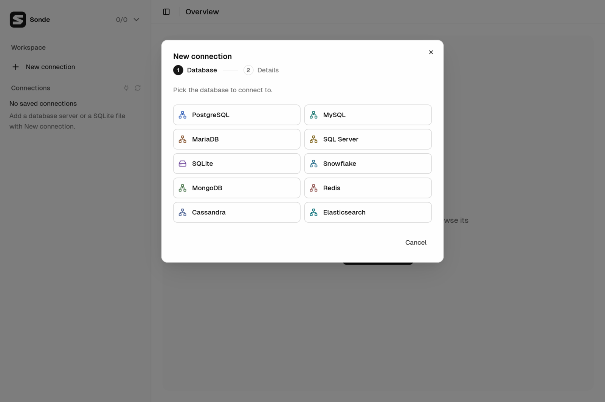

<div align="center">


# Sonde

**A fast, native desktop app for your databases.**

Connect, browse, query and edit ten kinds of database from one small app.
No browser engine, no Java. Just Rust and the GPU.

[](https://github.com/morisam1/sonde/actions/workflows/ci.yml)
[](https://github.com/morisam1/sonde/releases)
[](LICENSE)

[Download](#download) · [Features](#features) · [Shortcuts](#keyboard-shortcuts) · [Build from source](#build-from-source) · [Contribute](#contribute)



</div>

## Why Sonde

- **It is fast.** Sonde is written in Rust and draws with GPUI, the GPU toolkit from the Zed editor. It starts quickly, and large results scroll smoothly.
- **It is careful.** Sonde never changes data behind your back. Every edit and every structure change shows its exact statements first, and table edits run in one transaction.
- **It speaks many databases.** One app covers SQL servers, SQLite, document stores, key-value stores and search engines.
- **It is private.** Sonde has no account, no telemetry and no cloud. Passwords stay in your system keyring. The only thing it ever sends anywhere is the update check, and only if you allow it.

## Databases

| Database | Browse | Query | Edit data | Manage structure |
|---|:-:|:-:|:-:|:-:|
| PostgreSQL | ✓ | SQL | ✓ | ✓ |
| MySQL | ✓ | SQL | ✓ | ✓ |
| MariaDB | ✓ | SQL | ✓ | ✓ |
| SQL Server, Azure SQL | ✓ | SQL (and `GO`) | ✓ | ✓ |
| SQLite | ✓ | SQL | ✓ | ✓ |
| Snowflake | ✓ | SQL | ✓ | ✓ |
| MongoDB | ✓ | `mongosh` calls | ✓ | ✓ |
| Cassandra, ScyllaDB | ✓ | CQL | ✓ | ✓ |
| Redis, Valkey, KeyDB, Dragonfly | ✓ | commands | (with commands) | ✓ |
| Elasticsearch, OpenSearch | ✓ | SQL and REST | (with requests) | ✓ |

Each database takes its own language in the query tab:

- **SQL databases:** plain SQL. A script can hold many statements, and each one gets its own result.
- **MongoDB:** shell calls, like `db.orders.find({status: "open"}).sort({total: -1})`. `show dbs`, `use shop` and `db.runCommand({...})` work too.
- **Redis:** one command per line, like in `redis-cli`. `SCAN 0` runs to the end and lists every match.
- **Cassandra:** CQL.
- **Elasticsearch:** SQL, or REST requests written like in Kibana's console:

  ```
  GET /logs/_search
  { "query": { "match": { "message": "error" } } }
  ```

## Features

- **Saved connections.** Pick the engine, fill in the details, test, save. Or paste a URL such as `postgres://…`, `mysql://…`, `mongodb+srv://…` or `redis://…`.
- **Schema browser.** Schemas, tables, views, columns, keys and indexes in the sidebar. You can show one database or every database on the server.
- **Query editor.** Syntax colors, and completion for keywords, tables, columns, Redis commands and MongoDB collections.
- **Tabs.** Every query and table opens in its own tab, like in a code editor. A dot marks a query with unsaved changes.
- **Saved queries.** Save a query with `Ctrl+S` and it appears under **Saved queries** in the sidebar, ready to reopen on its connection. You can also open a `.sql` file from anywhere on disk; `Ctrl+S` then saves it back in place.
- **Big results.** Rows arrive in pages, so huge results never freeze the app. You can cancel a slow query at any time.
- **Safe editing.** Change cells, add and delete rows, then review the statements before anything is written. If a row changed since you loaded it, nothing is written.
- **Manage structure.** Right-click to create, rename, empty or drop databases, schemas, tables, collections, indexes, columns and keys.
- **Export.** Save any result as CSV or JSON.
- **History.** Each connection remembers what you ran.
- **Restore.** Your query tabs come back when you restart.
- **Light and dark.** Follows your system, or pick one.

<p align="center">
  
  
</p>

## Download

### Install with one command

**Linux and macOS:**

```sh
curl -fsSL https://raw.githubusercontent.com/morisam1/sonde/master/install.sh | sh
```

**Windows** (PowerShell):

```powershell
irm https://raw.githubusercontent.com/morisam1/sonde/master/install.ps1 | iex
```

The script picks the right package for your system, checks it against its published SHA-256 checksum, and installs it. Nothing needs root or administrator rights:

- **Linux:** the program goes in `~/.local/bin`, with a launcher in your app menu.
- **macOS:** `Sonde.app` goes in `/Applications`, or in `~/Applications` when you can't write to `/Applications`.
- **Windows:** Sonde goes in `%LOCALAPPDATA%\Programs\Sonde`, with a Start menu shortcut.

For the nightly build, set `SONDE_CHANNEL=nightly`. For one release, set `SONDE_VERSION`:

```sh
curl -fsSL https://raw.githubusercontent.com/morisam1/sonde/master/install.sh | SONDE_CHANNEL=nightly sh
curl -fsSL https://raw.githubusercontent.com/morisam1/sonde/master/install.sh | SONDE_VERSION=0.2.0 sh
```

```powershell
$env:SONDE_CHANNEL = "nightly"; irm https://raw.githubusercontent.com/morisam1/sonde/master/install.ps1 | iex
```

Want to read a script before you run it? Open [install.sh](install.sh) or [install.ps1](install.ps1). Both are short.

### Or download it yourself

Get Sonde from the [Releases page](https://github.com/morisam1/sonde/releases). There are two channels:

- **Stable:** tagged releases, such as `v0.2.0`. Start here.
- **Nightly:** a fresh build of the `master` branch, every time it changes. It has the newest features, and the newest bugs.

| System | File | How to install |
|---|---|---|
| Linux (x86-64) | `sonde-x86_64-unknown-linux-gnu.tar.gz` | Unpack it and run `sh sonde/install.sh`. |
| Windows (x86-64) | `sonde-x86_64-pc-windows-msvc.zip` | Unpack it anywhere and run `sonde.exe`. |
| macOS (Apple silicon and Intel) | `sonde-universal-apple-darwin.zip` | Unpack it and move `Sonde.app` to Applications. |

Each file has a `.sha256` file beside it, so you can check your download.

**macOS:** a build that isn't notarized and was downloaded with a browser is refused the first time. Right-click `Sonde.app`, choose **Open**, and confirm. The install script doesn't hit this, because `curl` doesn't mark files as downloaded.

**Linux:** Sonde runs on Wayland and X11. It needs Vulkan, which most desktops already have.

### Updates

On first start, Sonde asks how it may stay up to date:

- **Install automatically:** check once a day, then download and install new versions by themselves. The new version starts the next time you open Sonde.
- **Ask before installing:** check once a day, and tell you when a new version is out.
- **Don't check:** never check by itself.

You can change your answer, switch between Stable and Nightly, or check right now in **Settings → Updates**. You can also use **Check for updates** in the menu next to the Sonde logo.

A check asks GitHub for the list of Sonde releases. It sends nothing about you or your databases. Sonde installs a download only if it matches its published SHA-256 checksum.

## Getting started

1. Start Sonde. The first time, it asks for a connection. Paste a URL, or pick an engine and fill in the form.
2. Click a connection in the sidebar to connect. Open schemas and tables to see their columns, keys and indexes.
3. Right-click a connection and choose **New query**. Write a statement and press `Ctrl+Enter`.
4. Double-click a table to see its rows. Double-click a cell to edit it, then click **Apply** to review and save your changes.

### Keyboard shortcuts

| Keys | Action |
|---|---|
| `Ctrl+Enter` | Run the statement under the cursor, or the selection |
| `Ctrl+Shift+Enter` | Run the whole script |
| `Ctrl+Space` | Show completions |
| `Ctrl+T` | New query tab on the current connection |
| `Ctrl+S` | Save the query |
| `Ctrl+Shift+S` | Save the query under a new name |
| `Ctrl+O` | Open a `.sql` file |
| `Ctrl+W` | Close the tab (asks first if the query has unsaved changes) |
| `Ctrl+Tab`, `Ctrl+Page Down` | Next tab |
| `Ctrl+Shift+Tab`, `Ctrl+Page Up` | Previous tab |
| `Ctrl+B` | Show or hide the sidebar |
| `Enter` | Edit the selected cell (in a table) |
| `Delete` | Mark the selected row for deletion (in a table) |
| `Ctrl+C` | Copy the selected cells |

### Settings and files

Sonde keeps its files in one folder:

| System | Folder |
|---|---|
| Linux | `~/.config/sonde/` |
| macOS | `~/Library/Application Support/sonde/` |
| Windows | `%APPDATA%\sonde\config\` |

- `connections.toml` holds your saved connections. Passwords are never stored there; they go in the system keyring.
- `settings.toml` sets the editor font and size, the page size and the row limit. Sonde writes a commented copy the first time it starts.
- `queries/` holds your saved queries, as `.sql` files. The first line of each names the connection it runs on.
- `updates.toml` holds your update choice and channel.
- `layout.toml` holds the window size, the theme and the sidebar width.

### Notes for some databases

- **Snowflake:** sign in with a [programmatic access token](https://docs.snowflake.com/en/user-guide/programmatic-access-tokens) in the password field, and put your account identifier, like `myorg-myaccount`, in the Account field. Sonde is tested only against a fake Snowflake server so far, so please report problems.
- **MongoDB:** for most hosted clusters, add `authSource=admin` in the connection options.
- **Cassandra:** Sonde sends all traffic through the node you name; the cluster forwards each request to the right node. Edits run one at a time with `IF EXISTS`. Cassandra has no transactions across rows, so if an edit fails, the edits before it stay.
- **Redis and Elasticsearch:** rows are read-only in the table view. Change them with commands or requests in a query tab.

## Troubleshooting

- **Sonde asks for my password every time.** No keyring is running. Install and start GNOME Keyring or KWallet (Linux). macOS and Windows have one built in.
- **"Nothing is accepting connections".** Check the host and port, and that the server runs and accepts connections from your machine.
- **A connection fails with a certificate error.** Under **Encryption**, choose **Require** to encrypt without checking the certificate, or **Verify** only if the server has a trusted certificate.
- **The window is blank or Sonde will not start on Linux.** Sonde needs Vulkan. Check that `vulkaninfo` works, and that your GPU driver is installed.
- **Something else.** [Open an issue](https://github.com/morisam1/sonde/issues), with your system, the database and its version, and what you did.

## Build from source

You need Rust 1.94 or newer (install it with [rustup](https://rustup.rs)). On Linux you also need the development libraries for Vulkan, `libxkbcommon`, Wayland, X11, fontconfig and D-Bus. On Debian or Ubuntu:

```sh
sudo apt install build-essential pkg-config cmake clang libasound2-dev \
  libfontconfig-dev libfreetype-dev libwayland-dev libx11-xcb-dev libxcb1-dev \
  libxkbcommon-dev libxkbcommon-x11-dev libvulkan-dev libzstd-dev libdbus-1-dev
```

Then:

```sh
git clone https://github.com/morisam1/sonde.git
cd sonde
cargo run --release -p sonde-app
```

A build from source does not update itself. Pull and rebuild instead.

### Project layout

```
crates/sonde-core   Drivers, values, schema reading, statements, updater. No UI code.
crates/sonde-app    The GPUI app.
tests/              Docker files for the test databases.
packaging/          Files for the release packages.
.github/workflows/  CI, and the release builds.
```

`sonde-core` never depends on UI code. To add a database, write a driver there that implements the `Driver`, `Session` and `Dialect` traits in `driver.rs`. The app then works with it.

### Run the tests

The tests run against real databases in Docker:

```sh
docker compose -f tests/docker-compose.yml up -d --wait          # or name a few: ... --wait postgres redis
cargo test -p sonde-core                                         # drivers, against the containers
SONDE_TEST_MARIADB=1 cargo test -p sonde-core --test mysql       # the MySQL tests on MariaDB
cargo test -p sonde-app                                          # the app, with click-through tests
```

The containers listen on `127.0.0.1` only; their users and passwords are in `tests/docker-compose.yml`. The click-through tests drive the real app in a headless window and print one `PASS` or `FAIL` line per check. Set `SONDE_SHOTS=/some/dir` to save a screenshot of each step. The Snowflake and updater tests use small fake servers, so they need no account.

### Make a release

Set the new version in `Cargo.toml`, merge it to `master`, then push a tag such as `v0.2.0`. The release workflow builds all three systems and publishes the release. Every push to `master` refreshes the nightly release.

## Contribute

Bug reports, ideas and pull requests are welcome.

- Open an issue before a large change, so we can agree on the approach.
- Keep pull requests small and focused on one thing.
- Run `cargo fmt`, `cargo clippy --workspace --all-targets` and the tests before you push.
- Add a test with each fix or feature. Driver changes need an integration test in `crates/sonde-core/tests`.
- Write messages for users the way the app already does: say what happened, and what to check.

## Security

Please don't report security problems in public issues. Use [GitHub's private vulnerability reporting](https://github.com/morisam1/sonde/security/advisories/new) instead.

## Acknowledgments

Sonde stands on [GPUI](https://www.gpui.rs) from the Zed team, [gpui-component](https://github.com/longbridge/gpui-component), the [Lucide](https://lucide.dev) icons and the [Geist](https://vercel.com/font) font. It also uses the Rust drivers of each database: tokio-postgres, rusqlite, mysql_async, tiberius, the MongoDB and Redis drivers, and scylla.

## License

Sonde is free software, licensed under the [GNU General Public License, version 3](LICENSE) (GPL-3.0-only). You may use, study, share and change it. If you distribute Sonde or a changed version of it, you must give its source code under the same license.
